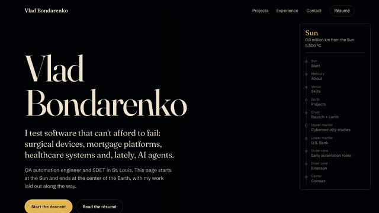

# vlad.yt

[](https://github.com/vladbondarenko97/vlad-yt/actions/workflows/test.yml)
[](https://vlad.yt)
[](LICENSE)

[](https://vlad.yt)

**Live: [vlad.yt](https://vlad.yt)**. I'm a QA automation engineer and SDET, so this portfolio
ships with its own test suite: 13 Playwright tests on desktop and phone, axe accessibility checks,
a no-WebGL fallback test and CI on every push. See [Tests](#tests).

Vlad Bondarenko's portfolio: one page that starts at the Sun and ends at the center of the
Earth. Scrolling flies a camera past Mercury and Venus to Earth, opens the planet, and
descends through the crust, mantle and core. The résumé is laid out along the way, and
each layer down is further back in time.

It is a static site. There is no backend and no framework: HTML, CSS, and one bundled
JavaScript file built on [three.js](https://threejs.org).

## Run it

```bash
npm install
npm run build     # bundles src/ into assets/js/app.js
npm run serve     # http://localhost:8080
```

`npm run watch` rebuilds on every save. The built bundle is committed, so the site also
works straight from a checkout with any static file server, with no `npm install`:

```bash
python3 -m http.server 8080
```

Double-clicking `index.html` works too, but browsers restrict pages opened from disk, so
the typefaces may fall back to system fonts there. Use a local server to see it as
visitors will.

## Deploy

It is a static site, so any static host works. vlad.yt is served by Apache from
`/var/www/vlad.yt`; deploying is copying `index.html` and `assets/` there (nothing else is
needed at runtime):

```bash
npm run build
tar czf - index.html assets | ssh <host> 'cd /var/www/vlad.yt && tar xzf -'
```

GitHub Pages also works: the `CNAME` file is already set to `vlad.yt`.

## Tests

End-to-end tests with [Playwright](https://playwright.dev), run on every push in CI, on a
desktop and a phone-sized Chromium:

```bash
npm install
npx playwright install chromium
npm test            # starts the static server itself
npx playwright test --ui   # watch mode with a time-travel debugger
```

| Test | What it protects |
|---|---|
| Loads cleanly | Title, `<h1>`, and zero console errors, page errors or failed/4xx requests |
| Stops match the gauge | Each of the 10 sections has a gauge link and the order agrees |
| Scrolling drives the gauge | Sun at the top, Earth in the middle, Center at the bottom |
| `?quality=low` | The quality override reaches the renderer |
| No WebGL | With `getContext('webgl')` removed the page falls back to a readable résumé |
| Reduced motion | Page loads and scroll still works with `prefers-reduced-motion` |
| Contact form | Validation blocks an empty submit; a valid one composes the email |
| Copy button | The address really lands on the clipboard |
| Résumé link | The PDF is served as `application/pdf` |
| Accessibility | [axe-core](https://github.com/dequelabs/axe-core) finds no serious WCAG A/AA violations |
| SEO | The headshot loads, the Person/ProfilePage JSON-LD is valid, and every `sameAs` profile is a `rel="me"` link |
| Engineering page | `/engineering/` is linked from the home page, loads cleanly and passes axe |

## Changing the content

| To change | Edit |
|---|---|
| Text, links, sections | `index.html` |
| Engineering evidence page | `engineering/index.html` |
| Résumé download | replace `assets/Vlad_Bondarenko_Resume.pdf` |
| Stop names, distances, temperatures, accent colors | `src/data/stops.js` |
| Camera position at each stop | `src/scene/journey.js` |
| Look of the page | `assets/css/style.css` |

Each `<section data-stop>` in `index.html` matches one entry in `src/data/stops.js`, in
the same order. Rebuild after changing anything under `src/`.

## How it works

```
src/
  main.js            renderer, quality tiers, frame loop
  data/stops.js      the ten stops and their real figures
  scene/
    world.js         sizes and positions of the bodies
    sun.js           convection-cell surface and corona
    planets.js       cratered rock (Mercury, Moon), Venus, atmosphere shells
    earth.js         surface, cutaway wedge, layer cross-section, inner core
    sky.js           stars, Milky Way, dust, orbit lines
    journey.js       camera pose per stop and the path between them
  shaders/chunks.js  simplex noise and shared GLSL
  ui/
    scroll.js        scroll position → journey position
    gauge.js         live distance, depth and temperature readout
    contact.js       mailto form and copy-address button
tools/               scripts that regenerate the Earth land mask; record-demo.mjs makes docs/demo.gif
```

- **Everything is drawn by shaders.** The Sun, the planets, the clouds and the lava are
  procedural noise. The only image is `assets/img/earth-land.webp`, a land mask built from
  Natural Earth data so the continents are the real ones (`npm run earth-mask`).
- **The cutaway is one comparison.** Earth's shader discards the part of the sphere where
  x, y and z all exceed a threshold. Lowering the threshold opens the wedge. Three flat
  faces fill the hole and color each pixel by its distance from the center, so the core
  and mantle boundaries sit at their real radii. The crust is drawn thicker than life so
  it can be seen.
- **Scroll drives the camera.** Each section owns a camera pose. The camera holds it while
  the section's text is at the top of the screen, then eases along a curve to the next.
- **It adapts to the device.** Three quality tiers set resolution, anti-aliasing and bloom.
  The page keeps timing real frames and steps down a tier when the GPU is struggling. Add `?quality=high`, `medium` or `low` to the URL to force one.
- **It degrades.** Without WebGL, or if a shader fails to compile, the page is a readable
  résumé on a gradient. Without HDR render targets it renders in 8 bits with no bloom.
  With "reduce motion" switched on, the camera follows the scroll exactly and ambient
  motion slows down.
- **It is built for phones too.** The canvas is sized to the large viewport so Safari's
  sliding toolbar never resizes it, a lost WebGL context is rebuilt when the tab comes
  back, and the frame-rate watchdog tolerates the 30 fps cap of iOS Low Power Mode.
- **It can report on itself.** Add `#debug` (or `?debug`) to the URL for an overlay with
  the GPU, quality tier, resolution, frame rate and any error. One screenshot of it is
  enough to diagnose a device you cannot plug into.

## Credits

- [three.js](https://threejs.org), MIT.
- 3D simplex noise by Ian McEwan and Stefan Gustavson, MIT.
- Coastlines from [Natural Earth](https://www.naturalearthdata.com) (public domain) via
  [world-atlas](https://github.com/topojson/world-atlas).
- Typefaces: Fraunces and Schibsted Grotesk, SIL Open Font License, self-hosted.
- Built with Claude Code.
